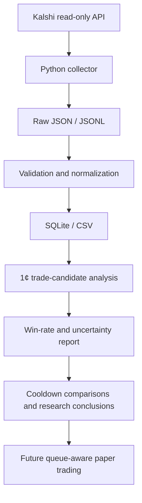

# Kalshi KXBTC15M | 1¢ Reversal Research

**Group 2 — Week 1 Prediction Market Deliverable**  
**Team:** Ganesh Kaladi · Daniel Petrov · Gautam Tangirala  
**Status:** Research and read-only data collection; strategy not validated or deployed.

> **Research only.** The existing `kalshi_nov13` work describes a local-fixture-tested, read-only collector. Its example records are **synthetic**, not live trading evidence. This project does not currently place, amend, or cancel orders, and no profitable backtest is claimed.

## 1. Project overview

We are investigating whether resting **$0.01 limit BUY orders on both YES and NO** in Kalshi's **15-minute Bitcoin Up/Down series (`KXBTC15M`)** can capture rare, large price reversals at a frequency sufficient to produce positive **net** expected value. We will collect market and trade data, distinguish observable trades from hypothetical order fills, and test a cooldown rule after successful 1¢ flips.

The relevant market is the **Kalshi KXBTC15M contract**, whose settlement uses the official **CF Benchmarks Bitcoin Real-Time Index (BRTI)** under its contract terms. It is **not** a BTC/USDT contract; exchange BTC/USDT quotes cannot substitute for Kalshi's official settlement result.

## 2. Hypothesis and proposed strategy

### Proposed entry and exit

1. At each eligible 15-minute market opening, **attempt to post a resting $0.01 BUY YES and $0.01 BUY NO limit order** for a predetermined fixed contract quantity.
2. If one side fills, **attempt to cancel the unfilled opposite-side order** promptly. Cancellation is not instantaneous: partial fills, dual fills, queue position, and latency must be tracked in future execution testing.
3. **Hold any purchased contracts to settlement**, looking for a low-probability outcome reversal.
4. After a **successful 1¢ flip**, wait **50–80 completed 15-minute market intervals** before resuming entries. The exact cooldown length is a parameter to compare, not a demonstrated optimal range.
5. **Keep position size fixed** across attempts. Although the slides call this a *martingale strategy*, it does **not** use traditional martingale stake doubling.

**Research claim to test:** Roughly 1 in 100 eligible 1¢ purchases might win. This is a *hypothesis*, not an observed result or a promise that one win occurs per 100 orders. A posted bid is not a purchase, and a public trade at 1¢ is not proof our order would have filled.

### Falsifiable statistical test

- **H₀:** Among actually fillable $0.01 purchases made under the defined strategy, the probability of winning is **≤ 1%**.
- **H₁:** Among those purchases, the probability of winning is **> 1%**.
- Compare **no cooldown**, **50 intervals**, **65 intervals**, and **80 intervals** using clearly separated historical and out-of-sample periods. Define the cooldown trigger and count consistently.

For one standard binary contract bought at $0.01 and held to a $1 winning settlement:

| Outcome | Gross P&L per contract |
|---|---:|
| Win | +$0.99 |
| Loss | −$0.01 |

**Gross expected P&L:** `p(win) − $0.01` per purchased contract.  
**Net expected P&L:** `p(win) − $0.01 − applicable fees − execution costs`.

A 1% win rate is **gross break-even before costs**. Fees, rounding, actual fill probability, and contract exceptions matter. Buying both sides without a successful cancellation can materially change the payoff.

## 3. Kalshi API and data schema

**Read-only API base:** `https://external-api.kalshi.com/trade-api/v2`

| GET endpoint | Intended use |
|---|---|
| `/series/KXBTC15M` | Series metadata, fees, contract terms |
| `/markets?series_ticker=KXBTC15M&status=open&limit=100` | Discover currently open markets |
| `/markets/{ticker}` | Market rules, timestamps, official result |
| `/markets/{ticker}/orderbook` | YES/NO bid price levels and quantities |
| `/markets/trades?ticker={ticker}&limit=1000&is_block_trade=false` | Executed trades and timestamps |
| `/markets?series_ticker=KXBTC15M&status=settled` | Discover settled outcomes |
| `/historical/cutoff` | Determine archive cutoffs |
| `/historical/markets`, `/historical/trades` | Older observations, planned extension |

Endpoint availability, schemas, pagination, fee rules, and historical access should be checked against current [Kalshi API documentation](https://docs.kalshi.com/). Public order-book data does not reveal our hypothetical position in the matching queue.

### Required fields

- Market ticker/ID, series, open/close timestamps, official settlement result.
- YES/NO bid levels, displayed quantities, trade price/quantity, execution timestamp, and available volume.
- Request/capture timestamps, response status, source URL, pagination cursor, and collection errors.
- Flags for missing data, market review, delayed settlement, and malformed observations.

Store **unaltered raw API responses in JSON/JSONL**, then normalize validated records into **CSV or SQLite** for analysis. Preserve UTC timestamps and precise decimal price representations.

## 4. Collector deliverable

Our Week 1 objective is to build a **Python, read-only Kalshi API collector** that:

- Targets **at least 30 days** of historical 15-minute BTC market observations; **up to six months** is preferable if obtainable.
- Records raw JSON, market IDs, timestamps, YES/NO prices, order books, trade volumes, and settled results.
- Identifies **observed 1¢ trades** and follows their associated markets to official settlement; these are **trade candidates**, not confirmed strategy fills.
- Handles **pagination, rate limits, network errors, and missing observations**.
- Stores data in a reproducible, structured format for statistical analysis and future backtesting.

**Important:** A live collector started today cannot retroactively reconstruct historical order-book snapshots. Historical trades, candlesticks, and outcomes can support descriptive analysis, but do not prove that a resting 1¢ bid would have filled.

## 5. Architecture



| Component | Technology | Purpose |
|---|---|---|
| Data source | Kalshi API | Retrieve market data |
| Collector | Python | Automate read-only collection |
| Raw storage | JSON / JSONL | Preserve original observations |
| Structured storage | SQLite / CSV | Enable reproducible queries |
| Analysis | Pandas / NumPy or Python | Evaluate 1¢ candidates and cooldowns |
| Future execution testing | Paper trading / fill-aware simulation | Assess realizable fills and cancellation behavior |

## 6. Existing Week 1 research files

The team's `kalshi_nov13` folder is documented as containing:

```text
kalshi_nov13/
├── README.md
├── SCHEMA.md
├── SUBMISSION.md
├── collector.py
├── analyze.py
├── demo_fixture.py
├── schema.sql
├── test_collector.py
├── architecture.dot
├── architecture.mmd
├── architecture.png
├── architecture.svg
└── examples/synthetic/
```

The earlier `kalshi_nov13/` documentation describes the commands below. **This new independent repository contains different starter code**, so use the new commands under **Quick start** instead:

```bash
python collector.py --once --data-dir data
python collector.py --interval 5 --data-dir data
python -m unittest test_collector.py -v
python analyze.py --db data/normalized.sqlite3 --out analysis
```

The documented outputs are `data/raw_responses.jsonl`, `data/normalized.sqlite3`, and analysis reports such as `analysis/candidate_trades.csv` and `analysis/summary.json`. Confirm the commands against the actual code before running them. Keep API keys and sensitive files out of Git.

## 7. Evaluation and success criteria

Report separately:

1. **Data coverage:** market windows observed, request success, missing periods, and number of settled markets.
2. **Observed candidates:** 1¢ public trades, unique candidate markets, and corresponding official outcomes.
3. **Uncertainty:** candidate win count/rate and **Wilson 95% confidence interval**; clearly identify trade-level proxy limitations and dependence.
4. **Execution realism:** estimated or measured fill rate, queue priority assumptions, cancellation delays, and partial/dual fills.
5. **Economic performance:** gross and net P&L, fees, drawdown, and exposure **only when execution assumptions are explicit**.
6. **Cooldown effect:** compare 0/50/65/80-interval policies without hindsight selection; evaluate on held-out data.

A candidate win rate above 1% alone is **not** proof of a profitable, executable strategy. The primary claim remains unconfirmed until fill-aware testing and net-cost analysis are complete.

## 8. Roadmap

- [x] Define initial strategy hypothesis and Week 1 architecture.
- [x] Document read-only collector and local synthetic-fixture workflow in the Nov 13 deliverable.
- [ ] Collect and validate at least 30 days of real KXBTC15M observations.
- [ ] Extend historical coverage where API data permits.
- [ ] Produce descriptive 1¢ candidate and settlement reports.
- [ ] Test 50–80 interval cooldown hypotheses against baseline policies.
- [ ] Build a queue-aware, fee-aware backtesting model.
- [ ] Paper-test simultaneous YES/NO orders and opposite-side cancellation.
- [ ] Review results and risk controls before considering any live execution.

## 9. Team and collaboration

**Group 2:** Ganesh Kaladi, Daniel Petrov, Gautam Tangirala.

Use feature branches and pull requests for changes to the collector, schema, analysis, and research documentation. Record data sources, time ranges, assumptions, and test results in each relevant pull request. No team member should publish private API credentials or imply synthetic outputs are real-market evidence.

## 10. Limitations and disclaimer

This project is educational and experimental. Public trades and periodic REST order-book snapshots do not establish hypothetical queue position or actual fills. Historical outcomes may contain selection bias, missing periods, or delayed/exceptional settlements. The strategy's statistical edge, executable profitability, and risk profile are **unknown**. No live trading functionality is claimed.

**References:** [Kalshi API documentation](https://docs.kalshi.com/) · [Kalshi Help Center](https://help.kalshi.com/)

## 11. Quick start — files included in this new repository

This is an **independently written starter implementation** aligned to the slides and Nov 13 research framing. It is **not** the original `kalshi_nov13` source code. The collector writes JSONL snapshots, **not yet SQLite**, and does not backfill historical data.

```bash
python -m unittest discover -s tests -v
python demo_fixture.py
python analyze.py --csv examples/synthetic/candidate_trades.csv --out analysis
# Optional live public-data GET snapshot (no API key or trading):
python collector.py --once --data-dir data
# Toy assumed-fill synthetic backtest, NOT execution evidence:
python -m backtesting.backtest --csv examples/synthetic/sample_markets.csv --cooldown 50
```

See [docs/SUBMISSION.md](docs/SUBMISSION.md), [docs/SCHEMA.md](docs/SCHEMA.md), and [docs/ARCHITECTURE.md](docs/ARCHITECTURE.md).
