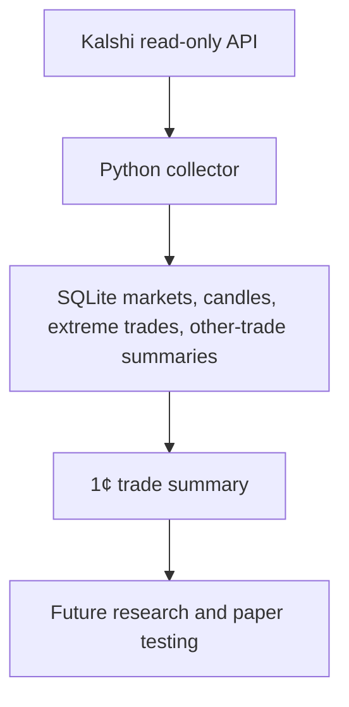

# Kalshi KXBTC15M | 1¢ Reversal Research

**Group 2 — Week 1 Prediction Market Deliverable**  
**Team:** Ganesh Kaladi · Daniel Petrov · Gautam Tangirala  
**Status:** Read-only historical collector implemented; strategy not validated or deployed.

> **Research only.** The existing `kalshi_nov13` work describes a local-fixture-tested, read-only collector. Its example records are **synthetic**, not live trading evidence. This project does not currently place, amend, or cancel orders, and no profitable backtest is claimed.

## 1. Project overview

We are investigating whether resting **$0.01 limit BUY orders on both YES and NO** in Kalshi's **15-minute Bitcoin Up/Down series (`KXBTC15M`)** can capture rare, large price reversals at a frequency sufficient to produce positive **net** expected value. We will collect market and trade data, distinguish observable trades from hypothetical order fills, and test a cooldown rule after successful 1¢ flips.

### Collect and analyze data

Run `python3 collector.py` to collect markets that **closed yesterday in UTC**. Use `--start YYYY-MM-DD --end YYYY-MM-DD` for a date range; both dates are included. The script needs Python 3.9+ and internet access, but no API key.

**Collected so far:** November 15, 2026 UTC—one calendar day of market closes, from 00:00 through 23:45 UTC. That is **not a rolling last 24 hours**. It covers 96 markets, including one that opened at 23:45 the previous day.

For each selected market, the collector fetches its metadata and settlement result, all public non-block trades during that market, and 1-minute candles. It does not collect order-book history or place orders. Data goes to `data/kalshi_compact.sqlite3`: complete market and candle records, individual 1–5¢ YES/NO trades, and minute-level counts and volume for other trades. Rerunning a date skips completed trade and candle downloads.

Run `python3 analyze.py` to summarize the 1¢ trades. The report describes public trades; it cannot tell whether our own order would have filled.

The relevant market is the **Kalshi KXBTC15M contract**, whose settlement uses the official **CF Benchmarks Bitcoin Real-Time Index (BRTI)** under its contract terms. It is **not** a BTC/USDT contract; exchange BTC/USDT quotes cannot substitute for Kalshi's official settlement result.

## 2. Hypothesis and proposed strategy

### Proposed entry and exit

1. At each eligible 15-minute market opening, **attempt to post a resting $0.01 BUY YES and $0.01 BUY NO limit order** for a predetermined fixed contract quantity.
2. If one side fills, **attempt to cancel the unfilled opposite-side order** promptly. Cancellation is not instantaneous: partial fills, dual fills, queue position, and latency must be tracked in future execution testing.
3. **Hold any purchased contracts to settlement**, looking for a low-probability outcome reversal.
4. After a **successful 1¢ flip**, wait **50–80 completed 15-minute market intervals** before resuming entries. The exact cooldown length is a parameter to compare, not a demonstrated optimal range.
5. **Keep position size fixed** across attempts. Although the slides call this a *martingale strategy*, it does **not** use traditional martingale stake doubling.

**Research claim to test:** Roughly 1 in 100 eligible 1¢ purchases might win. This is a *hypothesis*, not an observed result or a promise that one win occurs per 100 orders. A posted bid is not a purchase, and a public trade at 1¢ is not proof our order would have filled.

### Falsifiable statistical test

- **H₀:** Among actually fillable $0.01 purchases made under the defined strategy, the probability of winning is **≤ 1%**.
- **H₁:** Among those purchases, the probability of winning is **> 1%**.
- Compare **no cooldown**, **50 intervals**, **65 intervals**, and **80 intervals** using clearly separated historical and out-of-sample periods. Define the cooldown trigger and count consistently.

For one standard binary contract bought at $0.01 and held to a $1 winning settlement:

| Outcome | Gross P&L per contract |
|---|---:|
| Win | +$0.99 |
| Loss | −$0.01 |

**Gross expected P&L:** `p(win) − $0.01` per purchased contract.  
**Net expected P&L:** `p(win) − $0.01 − applicable fees − execution costs`.

A 1% win rate is **gross break-even before costs**. Fees, rounding, actual fill probability, and contract exceptions matter. Buying both sides without a successful cancellation can materially change the payoff.

## 3. Kalshi API and data schema

**Read-only API base:** `https://external-api.kalshi.com/trade-api/v2`

| GET endpoint | Intended use |
|---|---|
| `/series/KXBTC15M` | Series metadata, fees, contract terms |
| `/markets?series_ticker=KXBTC15M&status=open&limit=100` | Discover currently open markets |
| `/markets/{ticker}` | Market rules, timestamps, official result |
| `/markets/{ticker}/orderbook` | YES/NO bid price levels and quantities |
| `/markets/trades?ticker={ticker}&limit=1000&is_block_trade=false` | Executed trades and timestamps |
| `/markets?series_ticker=KXBTC15M&status=settled` | Discover settled outcomes |
| `/historical/cutoff` | Determine archive cutoffs |
| `/historical/markets`, `/historical/trades` | Older observations, planned extension |

Endpoint availability, schemas, pagination, fee rules, and historical access should be checked against current [Kalshi API documentation](https://docs.kalshi.com/). Public order-book data does not reveal our hypothetical position in the matching queue.

### Future data needs

- Market ticker/ID, series, open/close timestamps, official settlement result.
- YES/NO bid levels, displayed quantities, trade price/quantity, execution timestamp, and available volume.
- Request/capture timestamps, response status, source URL, pagination cursor, and collection errors.
- Flags for missing data, market review, delayed settlement, and malformed observations.

The compact database keeps raw market and candle records, individual 1–5¢ trades, and summaries for other trades.

## 4. Collector deliverable

The current read-only collector and 1¢ analysis cover one day. Remaining research work is to:

- Expand to **at least 30 days** of observations and audit missing periods.
- Compare cooldown and other hypotheses on data held out from the initial research period.
- Collect live order books if execution and fill analysis becomes worthwhile.

**Important:** A live collector started today cannot retroactively reconstruct historical order-book snapshots. Historical trades, candlesticks, and outcomes can support descriptive analysis, but do not prove that a resting 1¢ bid would have filled.

## 5. Architecture



| Component | Technology | Purpose |
|---|---|---|
| Data source | Kalshi API | Retrieve market data |
| Collector | Python | Automate read-only collection |
| Raw storage | `raw_json` for markets and candles | Preserve complete market metadata and candles |
| Structured storage | SQLite | Enable reproducible queries |
| Analysis | Python | Summarize observed 1¢ trades |
| Future execution testing | Paper trading / fill-aware simulation | Assess realizable fills and cancellation behavior |

## 6. Existing Week 1 research files

The team's `kalshi_nov13` folder is documented as containing:

```text
kalshi_nov13/
├── README.md
├── SCHEMA.md
├── SUBMISSION.md
├── collector.py
├── analyze.py
├── demo_fixture.py
├── schema.sql
├── test_collector.py
├── architecture.dot
├── architecture.mmd
├── architecture.png
├── architecture.svg
└── examples/synthetic/
```

The earlier `kalshi_nov13/` documentation describes the commands below. **This independent repository has its own collector**, so use the commands under **Run the collector** instead:

```bash
python collector.py --once --data-dir data
python collector.py --interval 5 --data-dir data
python -m unittest test_collector.py -v
python analyze.py --db data/normalized.sqlite3 --out analysis
```

Those are outputs from the earlier folder, not this repository. The compact collector writes `data/kalshi_compact.sqlite3`; keep local data and any future API keys out of Git.

## 7. Evaluation and success criteria

Report separately:

1. **Data coverage:** market windows observed, request success, missing periods, and number of settled markets.
2. **Observed candidates:** 1¢ public trades, unique candidate markets, and corresponding official outcomes.
3. **Uncertainty:** candidate win count/rate and **Wilson 95% confidence interval**; clearly identify trade-level proxy limitations and dependence.
4. **Execution realism:** estimated or measured fill rate, queue priority assumptions, cancellation delays, and partial/dual fills.
5. **Economic performance:** gross and net P&L, fees, drawdown, and exposure **only when execution assumptions are explicit**.
6. **Cooldown effect:** compare 0/50/65/80-interval policies without hindsight selection; evaluate on held-out data.

A candidate win rate above 1% alone is **not** proof of a profitable, executable strategy. The primary claim remains unconfirmed until fill-aware testing and net-cost analysis are complete.

## 8. Roadmap

- [x] Define initial strategy hypothesis and Week 1 architecture.
- [x] Document read-only collector and local synthetic-fixture workflow in the Nov 13 deliverable.
- [ ] Collect and validate at least 30 days of real KXBTC15M observations.
- [ ] Extend historical coverage where API data permits.
- [ ] Produce descriptive 1¢ candidate and settlement reports.
- [ ] Test 50–80 interval cooldown hypotheses against baseline policies.
- [ ] Build a queue-aware, fee-aware backtesting model.
- [ ] Paper-test simultaneous YES/NO orders and opposite-side cancellation.
- [ ] Review results and risk controls before considering any live execution.


