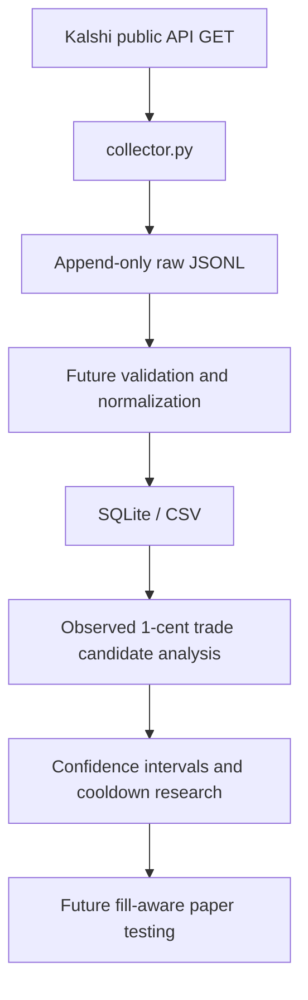

# Architecture

**Implemented:** read-only snapshot collection to JSONL, synthetic data generator, CSV candidate summary, and toy assumed-fill backtester.

**Planned:** historical backfill, SQLite ingestion, execution-aware dual-side order simulations, cancellation latency, out-of-sample validation.
