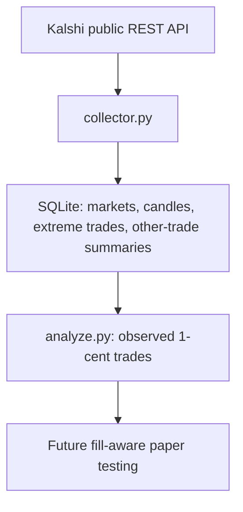

# Architecture

**Implemented:** read-only backfill by UTC market close date, archive cutoff handling, pagination, retries, SQLite storage with resumable per-market trade/candle downloads, and descriptive 1-cent trade analysis.

**Planned:** live order-book capture, execution-aware simulations, and out-of-sample validation.
